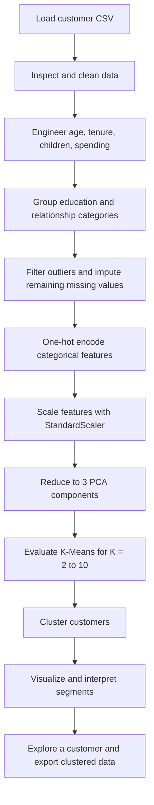

# 🛒 SmartCart — Customer Segmentation & Clustering

**Explore customer groups through purchasing behavior, household details, and customer demographics.**

SmartCart is an interactive data science project that prepares customer data, applies unsupervised clustering, and presents segment profiles and evaluation charts in a Streamlit dashboard. It is designed to support exploratory analysis and marketing discussions—not to predict a labeled outcome or establish business results.

[](https://www.python.org/)
[](https://streamlit.io/)
[](https://scikit-learn.org/)

## Project Overview

Customer records often contain many demographic and behavioral attributes, making it difficult to see meaningful patterns by inspection alone. SmartCart transforms those attributes into a scaled feature space, reduces its dimensionality with Principal Component Analysis (PCA), and groups customers using clustering algorithms.

The primary workflow uses **K-Means**, an unsupervised learning algorithm. The dashboard also offers Agglomerative Clustering for comparison. Cluster labels are exploratory groupings; they are not predefined customer types.

## Key Features

- Streamlit dashboard with light and dark appearance options.
- Customer data cleaning, feature engineering, categorical encoding, and scaling.
- Three-component PCA for clustering and reduced-dimensional visualization.
- K-Means cluster-count evaluation using WCSS (inertia) and silhouette score.
- K-Means and Agglomerative Clustering options, with a selectable cluster count.
- Cluster-size, income/spending, spending-distribution, and cluster-profile visualizations.
- Interactive assignment of entered customer details to an existing segment.
- Preview and CSV download of the clustered customer records.

## Problem Statement

Businesses need a practical way to explore how customers differ in purchasing patterns and household or demographic characteristics. SmartCart uses unsupervised clustering to reveal groups in the available customer data, which can inform further analysis and marketing hypotheses.

Clustering does not prove that a segment will respond to a campaign or improve business outcomes. Those claims require separate validation.

## Objectives

- Prepare the customer records for exploratory machine learning.
- Derive useful age, tenure, household, and spending features.
- Compare cluster counts using complementary internal evaluation metrics.
- Visualize and summarize the resulting customer segments.
- Make the analysis accessible through an interactive dashboard.

## Technologies and Libraries

| Technology | Use in the project |
|---|---|
| Python | Application and analysis notebook |
| Pandas, NumPy | Data preparation and numerical operations |
| Matplotlib | Dashboard and notebook visualizations |
| Seaborn | Exploratory plots in the notebook |
| Scikit-learn | Encoding, scaling, PCA, clustering, and silhouette evaluation |
| Streamlit | Interactive dashboard |
| Jupyter Notebook | Exploratory analysis in `smart_clustering.ipynb` |

The dashboard dependencies are pinned in [`requirements.txt`](requirements.txt). The notebook also imports Seaborn and `kneed`; install those separately when running the notebook if they are not already available.

## Dataset Description

The included `smartcart_customers.csv` contains **2,240 customer records** and **22 original attributes**. It includes:

- Demographic information, including birth year, education, and marital status.
- Income and household composition.
- Enrollment date and recency.
- Product spending and purchase counts across channels.
- Campaign response and complaint indicators.

The dashboard retains **2,236 records** after its age and income outlier filters. It imputes missing income values before filtering; the provided dataset has 24 missing income entries. The retained count and dashboard metrics are calculated from the data at runtime.

## Project Workflow



### 1. Data Loading and Initial Exploration

The app loads `smartcart_customers.csv` from the project directory and checks for the columns needed by the analysis. The notebook provides a companion exploratory workflow for inspecting the data and its attributes.

### 2. Data Cleaning and Missing Values

In the dashboard, missing income is filled with the median. After feature creation, remaining numeric missing values are filled with their column medians, while missing relationship and education values are filled with their modes. Records with age of 90 or above or income of 600,000 or above are excluded.

The notebook is an exploratory artifact and has some preprocessing differences: it fills missing income with the mean. Its intermediate outputs may therefore differ from the dashboard.

### 3. Feature Engineering

- **Age:** `2026 - Year_Birth`.
- **Customer tenure:** days between the customer's enrollment date and the latest enrollment date in the data.
- **Total children:** `Kidhome + Teenhome`.
- **Total spending:** sum of the six product-category spending fields.
- **Education groups:** `Basic` and `2n Cycle` are grouped as `UnderGraduate`; `Graduation` as `Graduate`; and `Master` and `PhD` as `PostGraduate`.
- **Relationship groups:** marital-status values are consolidated into `Partner` or `Single`.

The app removes original columns that are superseded by derived features, such as the raw birth year, enrollment date, household child counts, and individual product spending columns.

## Exploratory Data Analysis

The notebook supports exploratory pair plots and a correlation heatmap. In the dashboard, customers and clusters can be examined through:

- Cluster size and customer-share charts.
- Income versus total-spending scatter plots.
- Total-spending distributions by cluster.
- A cluster profile table and normalized behavior heatmap.
- PCA scatter plots colored by cluster assignment.

These views help compare the observed groups; interpretation should be based on the displayed customer profiles rather than assigning unsupported business labels.

## Data Preprocessing and Feature Engineering

Education and relationship categories are one-hot encoded. The resulting numeric and encoded features are standardized using `StandardScaler` so variables with larger numeric scales do not dominate solely because of their units.

The dashboard then fits PCA on the standardized features. Its transformations are reused when an entered customer is assigned to a segment.

## PCA and Dimensionality Reduction

PCA reduces the scaled feature set to **three components** for clustering. This gives the clustering algorithms a compact representation of the prepared customer attributes.

For the dashboard's two-dimensional scatter plot, the first two principal components are displayed. The notebook also includes a three-dimensional PCA visualization. PCA axes are combinations of input features and should not be read as individual business variables.

## Clustering Methodology

The primary algorithm is **K-Means**, an unsupervised method that partitions observations into a chosen number of clusters by minimizing within-cluster squared distances. SmartCart evaluates K-Means for `K = 2` through `K = 10` and uses `random_state=42` and `n_init=10` in the dashboard.

The dashboard also allows **Agglomerative Clustering** for comparison on the same PCA features. Cluster count can be selected in the sidebar. Cluster numbers are arbitrary identifiers; they do not imply ranking or a predefined segment meaning.

## Model Evaluation

The dashboard calculates K-Means evaluation curves on the three-component PCA features for cluster counts from 2 to 10. Silhouette evaluation uses a reproducible sample of up to 1,000 records to keep the dashboard responsive. Values depend on the input data and current preprocessing and are shown at runtime.

| Metric | What it indicates | How to read it |
|---|---|---|
| WCSS / inertia | Sum of squared distances from observations to their assigned K-Means centroids | Lower values indicate more compact clusters, but generally decrease as K increases. Look for an elbow where additional clusters yield smaller reductions. |
| Silhouette score | Relative cohesion within clusters and separation from other clusters | Higher values generally indicate better-separated clusters. Compare scores across tested K values; it is not a classification accuracy metric. |

Neither metric alone determines the most useful segmentation. Consider the curves together with cluster sizes and profile visualizations. No fixed best K or evaluation score is claimed in this README.

## Customer Segmentation Results

The dashboard presents results for the selected algorithm and cluster count, including:

- Number of customers in each cluster and each cluster's share.
- Mean income, recency, spending, age, tenure, and household children by cluster.
- PCA, income-versus-spending, spending-distribution, and normalized profile visualizations.
- A downloadable CSV containing the retained customer rows and their cluster labels.

The app also provides an interactive **Explore a New Customer** form. For K-Means, it assigns the entered record using the fitted model. Agglomerative Clustering does not provide a native out-of-sample `predict` method, so the app estimates an assignment using the nearest cluster centroid in PCA space. This is an exploratory segment assignment, not a supervised prediction.

The app initializes K-Means with four clusters by default, but users can change the count. Actual cluster sizes and evaluation scores are computed from the loaded data and are intentionally not hard-coded here.

## Project Structure

The following reflects the files present in this repository:

```text
.
├── main.py                   # Streamlit customer segmentation dashboard
├── smart_clustering.ipynb    # Exploratory analysis notebook
├── smartcart_customers.csv   # Customer dataset
├── requirements.txt          # Dashboard Python dependencies
└── my_pic.jpeg               # Image asset used by the app
```

## Installation and Setup

Use Python 3 and run the following commands from the project directory in PowerShell:

```powershell
python -m venv .venv
.\.venv\Scripts\Activate.ps1
python -m pip install --upgrade pip
pip install -r requirements.txt
```

If PowerShell prevents virtual-environment activation, use the Python executable inside `.venv` directly to run the commands below.

## How to Run the Project

### Streamlit dashboard

Ensure `smartcart_customers.csv` is in the same project directory as `main.py`, then run:

```powershell
streamlit run main.py
```

Streamlit prints a local URL in the terminal. Open that URL in a browser to use the dashboard.

### Exploratory notebook

To run the notebook, install Jupyter and the notebook-specific imports if needed:

```powershell
pip install jupyter seaborn kneed
jupyter notebook smart_clustering.ipynb
```

Run the notebook with the project directory as its working directory so it can find `smartcart_customers.csv`.

## Screenshots

No screenshots are included yet. Add genuine captures of the dashboard in this section when available; the placeholders below are intentionally not image links.

- Dashboard overview: _screenshot to be added_
- Cluster evaluation and profile: _screenshot to be added_

## Future Improvements

- Add tests for preprocessing and clustering behavior.
- Make the age reference year explicit and configurable rather than fixed in the feature calculation.
- Compare segment stability across repeated runs or alternative preprocessing choices.
- Add clearer guidance for interpreting cluster profiles without assigning unsupported business labels.
- Add real dashboard screenshots and document representative outputs after validating them against the dataset.

## Author

**Project author:** _Add your name and GitHub profile._
